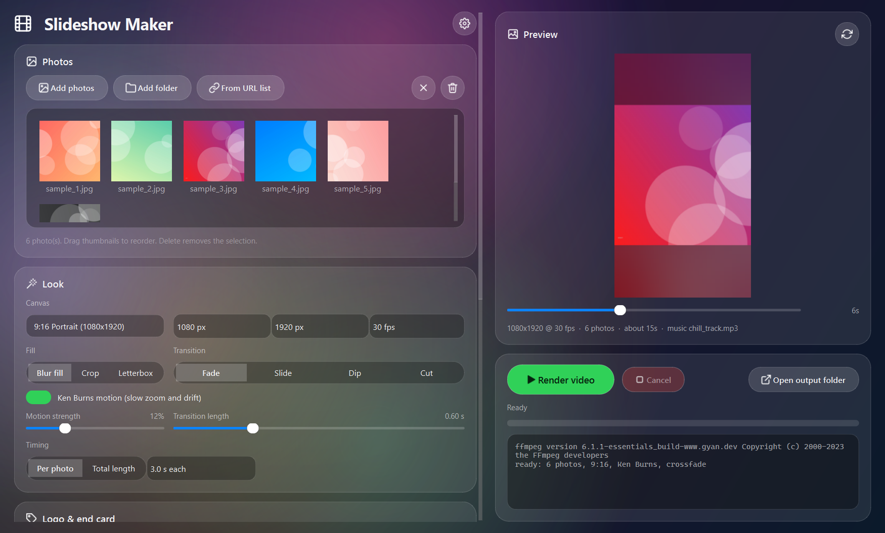

# Slideshow Maker

Turn a folder of photos, or a text file of image URLs, into polished vertical or landscape slideshow videos: Ken Burns motion, crossfade/slide transitions, blurred-background fill, a logo watermark, an end card and background music. One click renders a batch of videos for reels, shorts and stories.



## Features

- **Sources**: add photos, whole folders, drag-and-drop, or a `.txt` list of image URLs (downloaded at render time, broken and tiny images skipped).
- **Batch**: split the photos into N videos, optional shuffle, timestamped output names.
- **Canvas presets**: 9:16, 1:1, 16:9, 4:5, 4:3 or any custom size, any fps.
- **Fill modes**: blurred-background fill (no black bars), crop to fill, or letterbox.
- **Motion**: Ken Burns slow zoom and drift, reproducible per image, strength slider.
- **Transitions**: crossfade, slide, dip to black, or hard cut, with adjustable length.
- **Timing**: seconds per photo, or a total length that the per-photo time is solved from.
- **Logo** overlay with position, size and opacity; shown on every photo except the end card.
- **End card** image with its own duration.
- **Music**: a track or a folder (random track per video), volume, fade-out, looped or trimmed to the video.
- **Live preview**: scrub through the timeline and see the exact frame the renderer will produce.
- **Command line** mode for scripting: `slideshow-maker --cli`.
- Renders on a worker thread with exact progress and instant cancel; the log shows the FFmpeg command used.

## How it renders

Every frame is composed in Python (NumPy + Pillow) and streamed as raw RGB into FFmpeg, which encodes H.264 + AAC. That keeps the preview and the output identical, gives frame-accurate progress, and avoids fragile multi-hundred-node filter graphs. A 60 s 1080x1920 video takes about a minute on a laptop CPU.

## Install

**Windows exe**: download `SlideshowMaker.exe` from the [latest release](https://github.com/PhantomAnas/slideshow-maker/releases/latest). You also need **FFmpeg** on your PATH: get a build from [ffmpeg.org](https://ffmpeg.org/download.html) (on Windows, `winget install Gyan.FFmpeg` works) and restart the app. FFmpeg is not bundled.

**From source** (Windows, macOS, Linux):

```
git clone https://github.com/PhantomAnas/slideshow-maker
cd slideshow-maker
python -m venv .venv && .venv\Scripts\activate      # or: source .venv/bin/activate
pip install -e .
slideshow-maker
```

## Use

1. **Photos**: Add photos or a folder (drag-and-drop works too), reorder by dragging thumbnails. Or choose *From URL list* and point at a `.txt` with one image URL per line.
2. **Look**: pick a canvas preset, fill mode, transition, motion and timing. The preview updates as you change things; drag the scrubber to see any moment.
3. **Logo & end card**, **Music**, **Output**: all optional.
4. **Render video**. Videos land in the output folder (default `~/Videos/Slideshow Maker`).

Settings are remembered between runs (`%LOCALAPPDATA%\SlideshowMaker\settings.json` on Windows).

### Command line

```
slideshow-maker --cli --images ./photos --out ./videos --aspect 9:16 --per-image 2.5 --music ./tracks
slideshow-maker --cli --links links.txt --videos 3 --logo logo.png --end-card thanks.png --total 30
slideshow-maker --cli --check          # is FFmpeg found?
```

With no flags the CLI reuses the settings saved by the window.

## Development

```
pip install -e ".[dev]"
pytest                        # engine, timeline, downloader (local HTTP server) and real FFmpeg renders
pyinstaller slideshow.spec    # builds dist/SlideshowMaker.exe
python scripts/make_samples.py samples   # generated demo photos (no real photographs in the repo)
python scripts/screenshot.py
```

Layout: `src/slideshow_maker/` has the engine (`imaging.py`, `timeline.py`, `render.py`, `downloader.py`, `batch.py`), `settings.py`, `cli.py`, and the PySide6 front end under `app/` (`main_window.py`, `widgets.py`, `theme.py`, `icons.py`, `worker.py`).

## Notes

- FFmpeg: found on PATH, next to the exe, or via the `SLIDESHOW_FFMPEG` environment variable. Without `ffprobe` the app still works (it parses `ffmpeg -i` output).
- Downloaded images are cached under `<output>/.cache/`; delete it whenever you like.
- Only download and use images and music you have the rights to.

## License

MIT. PySide6 is used under the LGPL; FFmpeg is called as an external program.
